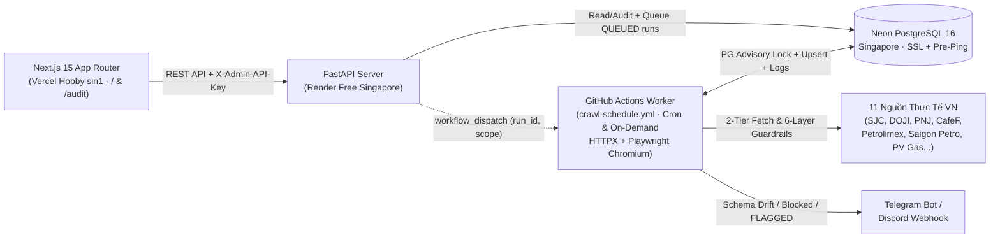

# VXG Tracker

Hệ thống tự động thu thập, kiểm chứng nguồn gốc và hiển thị bảng giá hàng ngày cho **3 mặt hàng thiết yếu tại Việt Nam** (**Vàng**, **Xăng dầu**, **Gas**) tại **Hà Nội (`HN`)**, **Đà Nẵng (`DN`)** và **TP. Hồ Chí Minh (`HCM`)**.

> **Phạm vi Phase 1 (Strict Scope):** Tập trung 100% vào dữ liệu thực tế từ **11 nguồn chính thức và đối chứng**, kiểm chứng **6 tầng an toàn**, lưu trữ chuỗi thời gian sạch theo múi giờ **`Asia/Ho_Chi_Minh` (`UTC+7`)**, cung cấp hồ sơ bằng chứng gốc (`SHA-256` + link nguồn) và minh bạch toàn bộ nhật ký kiểm toán. **Tuyệt đối không** dùng dữ liệu giả lập (mock) và **chưa có** tính năng dự đoán giá (AI forecasting).

---

## Kiến trúc 100% Miễn phí chuẩn Production & Local

- **Local Development:** Docker Compose 1 lệnh với `postgres` + `migrator` + `api` (`WORKER_DISPATCH_MODE=db_poll`) + `worker` (APScheduler daemon + poll queue) + `web`.
- **Production Free Stack (Singapore):**
  - **Neon PostgreSQL 16** (tự động chuẩn hóa `sslmode`/`channel_binding` cho `asyncpg` & `psycopg`, `pool_pre_ping=True`, `pool_recycle=300`).
  - **Render Free (`vxg-api`)** — FastAPI server cấu hình bằng [`render.yaml`](render.yaml), tự động chạy migration/seed lúc boot qua [`apps/api/entrypoint.sh`](apps/api/entrypoint.sh), nhận nút *"Chạy cào thủ công"* trên `/audit` và dispatch tới GitHub Actions (`WORKER_DISPATCH_MODE=github_actions`).
  - **GitHub Actions Crawler Worker** ([`.github/workflows/crawl-schedule.yml`](.github/workflows/crawl-schedule.yml)) — Chạy lịch định kỳ theo giờ Việt Nam (`UTC+7`) và thực thi theo `--run-id` khi admin kích hoạt thủ công trên UI.
  - **Vercel Hobby (`apps/web`)** — Next.js 15 App Router deploy tại region `sin1` ([`apps/web/vercel.json`](apps/web/vercel.json)).



---

## Tính năng cốt lõi

- **2-Tier Fetcher & Chống chặn bot:** Ưu tiên `httpx` với HTTP header chuẩn `vi-VN`, retry exponential backoff + jitter; tự fallback sang **Playwright Chromium** headless khi trang render JS hoặc gặp WAF/cookie challenge.
- **Kiểm chứng 6 tầng (`6-Layer Validation Guardrails`) & Đối chứng chéo:** Kiểm tra kiểu/SHA-256/URL, chặn giá `<= 0`, kiểm tra logic mua/bán & quy cách bình gas, kiểm tra biên độ hợp lý, chống nhảy giá đột biến (`PRICE_SPIKE_THRESHOLD_PCT=15%`), chuẩn hóa `Asia/Ho_Chi_Minh`, idempotent upsert và đối chiếu chéo Tier 1 ↔ Tier 2 (`CROSS_CHECKED`).
- **Zero Stuck Jobs & Fail-Safe:** Khi ở chế độ `github_actions`, nếu lệnh dispatch sang GitHub API thất bại (timeout hoặc HTTP 4xx/5xx), API lập tức cập nhật bản ghi `crawl_runs` sang `FAILED` và trả mã lỗi `502 GITHUB_DISPATCH_FAILED` thống nhất.
- **Snapshot Retention 90 ngày:** Tự động xóa bản nén gzip `raw_evidence_snapshots` quá hạn mà vẫn giữ toàn vẹn `price_records`, `crawl_runs` và SHA-256 của mức giá `VERIFIED` mới nhất.
- **Giao diện Financial / Editorial (`tabular-nums`):** Bảng giá tối giản, quy đổi nhanh **VND / Lượng ↔ VND / Chỉ**, **Evidence Drawer** kiểm chứng nguồn gốc và trang `/audit` đầy đủ.

---

## Cấu trúc Monorepo

| Thành phần | Đường dẫn | Vai trò chính |
| :--- | :--- | :--- |
| **Shared Package** | [`packages/shared-py`](packages/shared-py) | SQLAlchemy 2.0 ORM (8 bảng), Alembic migrations, Neon SSL/pool normalizer, `Asia/Ho_Chi_Minh` timezone, SHA-256 hashing, `seed.py` |
| **REST & Audit API** | [`apps/api`](apps/api) | FastAPI `/api/v1/*`, Render [`entrypoint.sh`](apps/api/entrypoint.sh), hỗ trợ `db_poll` & `github_actions` dispatch, Production `ADMIN_API_KEY` guard |
| **Scraper Worker** | [`apps/worker`](apps/worker) | 2-Tier Fetcher, 11 adapters VN thật, 6-Layer Guardrails, CLI `--run-id`, APScheduler `UTC+7` (local), `AlertNotifier`, Snapshot Retention |
| **Web Dashboard** | [`apps/web`](apps/web) | Next.js 15 + Tailwind v4 (`/` Bảng giá, Evidence Drawer, `/audit` Kiểm toán & Modal chạy thủ công hỗ trợ cold start) |
| **CI Workflow** | [`.github/workflows/ci.yml`](.github/workflows/ci.yml) | Lint, `mypy`, offline `pytest`, integration test trên Postgres 16, Next.js build + secret scan, Docker Buildx check |
| **Crawler Workflow** | [`.github/workflows/crawl-schedule.yml`](.github/workflows/crawl-schedule.yml) | Scheduled cron (`UTC+7`) + `workflow_dispatch` nhận `scope` & `run_id` chạy Playwright trên `ubuntu-latest` |
| **Render Blueprint** | [`render.yaml`](render.yaml) | Cấu hình deploy `vxg-api` miễn phí tại region Singapore |
| **Hướng dẫn Deploy** | [`docs/DEPLOYMENT.md`](docs/DEPLOYMENT.md) | Hướng dẫn từng bước triển khai **Neon + GitHub Actions + Render Free + Vercel Hobby + cron-job.org** |

---

## Danh sách 11 Nguồn Dữ liệu Thực tế đang Active

| Nhóm | Mã nguồn (`code`) | Phân tầng | Chiến lược | Lịch quét (`UTC+7`) |
| :--- | :--- | :--- | :--- | :--- |
| **Vàng** | `SJC_OFFICIAL_XML` | Chính thống (`PRIMARY_OFFICIAL`) | `HTTP_JSON` | `08:45`, `11:30`, `15:20`, `17:15` |
| **Vàng** | `DOJI_BOARD` | Chính thống (`PRIMARY_OFFICIAL`) | `PLAYWRIGHT_JS` | Cùng lịch Vàng |
| **Vàng** | `PNJ_HTML` | Chính thống (`PRIMARY_OFFICIAL`) | `PLAYWRIGHT_JS` | Cùng lịch Vàng |
| **Vàng** | `CAFEF_GOLD_CROSSCHECK` | Đối chứng (`SECONDARY_CROSSCHECK`) | `HTTP_JSON` | Cùng lịch Vàng |
| **Xăng dầu** | `PETROLIMEX_FUEL` | Chính thống (`PRIMARY_OFFICIAL`) | `PLAYWRIGHT_JS` | `15:20` & `17:15` (cùng `ALL`) |
| **Xăng dầu** | `SAIGONPETRO_FUEL` | Chính thống (`PRIMARY_OFFICIAL`) | `HTTP_HTML` (2 bước) | Cùng lịch Xăng dầu |
| **Xăng dầu** | `WEBGIA_FUEL_CROSSCHECK` | Đối chứng (`SECONDARY_CROSSCHECK`) | `HTTP_HTML` | Cùng lịch Xăng dầu |
| **Gas** | `PETROLIMEX_GAS` | Chính thống (`PRIMARY_OFFICIAL`) | `PLAYWRIGHT_JS` | `15:20`, `17:15` & `03:15` ngày 01 |
| **Gas** | `SAIGONPETRO_GAS` | Chính thống (`PRIMARY_OFFICIAL`) | `HTTP_HTML` (2 bước) | Cùng lịch Gas |
| **Gas** | `PVGAS_LPG` | Chính thống (`PRIMARY_OFFICIAL`) | `PLAYWRIGHT_JS` | Cùng lịch Gas |
| **Gas** | `VIETNAMBIZ_GAS_CROSSCHECK` | Đối chứng (`SECONDARY_CROSSCHECK`) | `HTTP_HTML` (2 bước) | Cùng lịch Gas |

*(Trên Docker Compose local, `vxg_worker` chạy đầy đủ bộ 10 job APScheduler chi tiết hơn theo ngày trong tuần/giờ Việt Nam.)*

---

## REST & Audit API Endpoints (`/api/v1/...`)

| Method & Path | Bảo vệ | Mô tả |
| :--- | :--- | :--- |
| `GET /health`, `GET /ready` | Công khai | Liveness & Readiness probe kiểm tra PostgreSQL + catalog |
| `GET /docs`, `GET /openapi.json` | Công khai | Swagger UI & OpenAPI schema |
| `GET /api/v1/catalog` | Công khai | Danh sách thành phố (`HN`, `DN`, `HCM`), nhóm hàng, 18 mặt hàng, 11 nguồn active |
| `GET /api/v1/prices/latest` | Công khai | Bảng giá `VERIFIED`/`CROSS_CHECKED` mới nhất (lọc `location`, `domain`; tự map `FUEL -> VUNG_1`) |
| `GET /api/v1/prices/{record_id}/evidence` | Công khai | Toàn bộ bằng chứng nguồn gốc, SHA-256, mã phiên cào, kết quả đối chứng & 6 tầng kiểm tra |
| `GET /api/v1/audit/summary` | Công khai | Chỉ số minh bạch theo ngày hôm nay (`UTC+7`) và 7 ngày gần nhất |
| `GET /api/v1/audit/runs` | Công khai | Lịch sử các phiên cào (hỗ trợ phân trang `limit`/`offset`, lọc `scope`/`status`) |
| `GET /api/v1/audit/runs/{run_id}` | Công khai | Log chi tiết từng nguồn (`crawl_source_logs`) trong một phiên cào |
| `GET /api/v1/sources/health` | Công khai | Tỷ lệ thành công 7 ngày, độ trễ trung bình và trạng thái hiện tại của 11 nguồn active |
| `GET /api/v1/audit/anomalies` | Công khai | Danh sách cảnh báo `anomaly_alerts` (`OPEN` / `ACKNOWLEDGED` / `RESOLVED`) |
| `POST /api/v1/admin/crawl-runs` | `X-Admin-API-Key` | Tạo job `QUEUED` (`202` / `409 Conflict` / `502` nếu dispatch GitHub lỗi) |

---

## Chạy nhanh trên Local (Docker Compose)

1. **Tạo file biến môi trường `.env` từ [`.env.example`](.env.example):**
   - **Windows PowerShell:**
     ```powershell
     Copy-Item .env.example .env
     ```
   - **macOS / Linux:**
     ```bash
     cp .env.example .env
     ```
2. **Khởi chạy toàn bộ 5 dịch vụ local (`postgres`, `migrator`, `api`, `worker`, `web`):**
   ```bash
   docker compose up --build -d
   ```
3. **Nạp dữ liệu giá thực tế ngay lần đầu (không cần chờ khung giờ cron):**
   ```bash
   docker compose exec worker python -m vxg_worker.cli run --scope ALL
   ```
   *(Hoặc vào `http://localhost:3000/audit`, bấm **Chạy cào thủ công** và nhập khóa mặc định local `change-me-local-admin-key`.)*
4. **Truy cập trên trình duyệt:**
   - **Bảng giá hôm nay:** `http://localhost:3000` (hỗ trợ `?city=HN|DN|HCM`)
   - **Minh bạch & Nhật ký cào:** `http://localhost:3000/audit`
   - **OpenAPI / Swagger UI:** `http://localhost:8000/docs`

---

## Kiểm thử & Phát triển

```powershell
# Backend lint, strict typecheck & unit/integration tests (Windows PowerShell)
.\.venv\Scripts\ruff.exe check packages apps/api apps/worker tests
.\.venv\Scripts\mypy.exe packages/shared-py/src apps/api/src apps/worker/src tests
.\.venv\Scripts\pytest.exe tests/unit -v
.\.venv\Scripts\pytest.exe tests/integration -v

# Frontend lint, typecheck & build
pnpm --dir apps/web lint
pnpm --dir apps/web typecheck
pnpm --dir apps/web build
```

Hoặc sử dụng [`Makefile`](Makefile): `make up`, `make down`, `make test`, `make test-integration`, `make lint`, `make web-build`, `make prune-snapshots`.

---

## Triển khai 100% Miễn phí lên Cloud

Xem hướng dẫn chi tiết từng bước cài đặt **Neon (PostgreSQL) + GitHub Actions (Worker) + Render Free (FastAPI) + Vercel Hobby (Next.js) + cron-job.org** tại [`docs/DEPLOYMENT.md`](docs/DEPLOYMENT.md).
