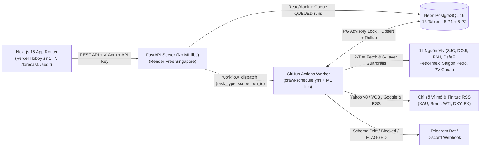

# VXG Tracker

Hệ thống tự động thu thập, kiểm chứng nguồn gốc, phân tích tín hiệu vĩ mô/tin tức và dự báo định lượng hàng ngày cho **3 mặt hàng thiết yếu tại Việt Nam** (**Vàng**, **Xăng dầu**, **Gas**) tại **Hà Nội (`HN`)**, **Đà Nẵng (`DN`)** và **TP. Hồ Chí Minh (`HCM`)**.

> **Nguyên tắc dữ liệu (Phase 1 + Phase 2):** Toàn bộ số liệu giá kiểm toán lấy từ **11 nguồn chính thức và đối chứng**, kiểm chứng **6 tầng an toàn**, tách bạch hoàn toàn **8 bảng Phase 1** với **5 bảng Phase 2** (`daily_price_series`, `macro_indicators`, `market_news_signals`, `price_forecasts`, `forecast_evaluations`). **Tuyệt đối không** dùng dữ liệu giả lập (mock); các mã chưa đủ lịch sử trả rõ trạng thái `INSUFFICIENT_DATA`.

---

## Kiến trúc 100% Miễn phí chuẩn Production & Local

- **Local Development:** Docker Compose 1 lệnh với `postgres` + `migrator` + `api` (`WORKER_DISPATCH_MODE=db_poll`) + `worker` (APScheduler daemon + poll `crawl_runs` & `forecast_runs`) + `web`.
- **Cô lập ML Runtime (Render Free 512MB RAM Safe):** `numpy` và `scikit-learn` chỉ cài đặt trong [`apps/worker`](apps/worker); [`packages/shared-py`](packages/shared-py) và [`apps/api`](apps/api) giữ nhẹ tối đa để chạy ổn định trên **Render Free**.
- **Production Free Stack (Singapore):**
  - **Neon PostgreSQL 16** (tự động chuẩn hóa `sslmode`/`channel_binding` cho `asyncpg` & `psycopg`, `pool_pre_ping=True`, `pool_recycle=300`).
  - **Render Free (`vxg-api`)** — FastAPI server cấu hình bằng [`render.yaml`](render.yaml), tự động chạy migration `0001`→`0004` + seed lúc boot qua [`apps/api/entrypoint.sh`](apps/api/entrypoint.sh), nhận kích hoạt thủ công trên `/audit` và dispatch tới GitHub Actions (`WORKER_DISPATCH_MODE=github_actions`).
  - **GitHub Actions Worker** ([`.github/workflows/crawl-schedule.yml`](.github/workflows/crawl-schedule.yml) & [`.github/workflows/backfill-history.yml`](.github/workflows/backfill-history.yml)) — Chạy định kỳ hằng ngày lúc **00:15 (`UTC+7`)**: cào giá (`ALL`), đồng bộ vĩ mô, đồng bộ tin tức RSS, chấm điểm `evaluate-forecasts`, sinh dự báo `run-forecasts`, và dọn snapshot quá 90 ngày.
  - **Vercel Hobby (`apps/web`)** — Next.js 15 App Router deploy tại region `sin1` ([`apps/web/vercel.json`](apps/web/vercel.json)) gồm **3 trang**: `/` (`Bảng giá`), `/forecast` (`Phân tích & Dự báo` dùng `lightweight-charts` v5) và `/audit` (`Kiểm toán dữ liệu` + Tab `Độ chính xác dự báo`).



---

## Tính năng cốt lõi

- **Thu thập & Kiểm chứng Phase 1:** 2-Tier Fetcher (`httpx` + Playwright Chromium headless), kiểm chứng 6 tầng (`6-Layer Validation Guardrails`), đối chiếu chéo Tier 1 ↔ Tier 2 (`CROSS_CHECKED`), `SHA-256` & snapshot retention 90 ngày, Fail-Safe `QUEUED` timeout 15 phút.
- **Lịch sử & Tín hiệu Vĩ mô/Tin tức (M7 & M8):**
  - Chuỗi chuẩn hóa `daily_price_series` (backfill CafeF Gold 2 năm HCM, Saigon Petro Fuel 16 tháng Vùng 1, Saigon Petro & VietNamBiz Gas HCM) + tự động `LIVE_ROLLUP` sau mỗi phiên cào Phase 1.
  - Chỉ số vĩ mô (`XAU_USD`, `BRENT_USD`, `WTI_USD`, `DXY`, `USD_VND_VCB`, `USD_VND_MARKET`) và công thức minh bạch **Chênh lệch Vàng SJC vs Thế giới quy đổi** (`XAU_USD * (37.5 / 31.1034768) * USD_VND`).
  - Động cơ tin tức RSS 2 tầng (mặc định 0 đồng với Deterministic Lexicon & Catalyst Engine + tùy chọn `GEMINI_API_KEY` fallback an toàn).
- **Động cơ Dự báo 3 ngành & Chấm điểm minh bạch (M9):**
  - **Zero Look-Ahead Bias** tuyệt đối (`<= as_of`): *Vàng* (`T+1`, `T+7` — HuberRegressor trên chênh lệch nội/ngoại, XAU, DXY, tỷ giá), *Xăng dầu* (Kỳ điều hành Thứ Năm `15:00` — Ridge trên bình quân 7 ngày Brent/WTI/FX trong kỳ so với kỳ trước), *Gas* (Kỳ đầu tháng — Pass-Through khi `<12` tháng, tự nâng cấp Ridge khi đủ `>=12` tháng).
  - Risk Overlay từ tin tức tác động cao (`high_volatility_flag`), Walk-Forward Backtest so sánh `Naive Baseline`, và tách biệt nghiêm ngặt số liệu **`LIVE`** với **`BACKTEST`**.
- **Giao diện Financial / Editorial (`tabular-nums`, M10):** Bảng giá tối giản kèm `prev_change_vnd/pct` và Evidence Drawer tại `/`, biểu đồ `lightweight-charts` v5 + 3 chỉ số cốt lõi + 2 tab giải thích tại `/forecast`, và Tab thứ 4 `Độ chính xác dự báo` tại `/audit`.

---

## Cấu trúc Monorepo

| Thành phần | Đường dẫn | Vai trò chính |
| :--- | :--- | :--- |
| **Shared Package** | [`packages/shared-py`](packages/shared-py) | SQLAlchemy 2.0 ORM (13 bảng P1+P2), Alembic migrations `0001`→`0004`, Neon SSL/pool normalizer, `gold_parity`, `Asia/Ho_Chi_Minh`, `seed.py` |
| **REST & Audit API** | [`apps/api`](apps/api) | FastAPI `/api/v1/*` (nhẹ, không ML libs), Render [`entrypoint.sh`](apps/api/entrypoint.sh), hỗ trợ `db_poll` & `github_actions` dispatch |
| **Worker & Forecasting** | [`apps/worker`](apps/worker) | 2-Tier Fetcher, 11 adapters VN thật, backfill lịch sử, macro & RSS engine, ML forecasting (`numpy`/`scikit-learn`), CLI & APScheduler |
| **Web Dashboard** | [`apps/web`](apps/web) | Next.js 15 + Tailwind v4 + `lightweight-charts` v5 (`/` Bảng giá, `/forecast` Phân tích & Dự báo, `/audit` Kiểm toán & Modal thủ công) |
| **CI / Workflows** | [`.github/workflows`](.github/workflows) | `ci.yml` (Lint, mypy, unit + PG integration, Next build, YAML check, Docker Buildx), `crawl-schedule.yml` (cron & on-demand), `backfill-history.yml` |
| **Hướng dẫn Deploy** | [`docs/DEPLOYMENT.md`](docs/DEPLOYMENT.md) | Quy trình từng bước triển khai Phase 1 + Phase 2 lên **Neon + GitHub Actions + Render Free + Vercel Hobby + cron-job.org** |

---

## REST, Analytics, Forecast & Audit API Endpoints (`/api/v1/...`)

| Method & Path | Bảo vệ | Mô tả |
| :--- | :--- | :--- |
| `GET /health`, `GET /ready`, `GET /docs` | Công khai | Liveness/Readiness probe & Swagger UI / OpenAPI |
| `GET /api/v1/catalog` | Công khai | Danh sách thành phố (`HN`, `DN`, `HCM`), 18 mặt hàng, 11 nguồn active |
| `GET /api/v1/prices/latest` | Công khai | Bảng giá `VERIFIED`/`CROSS_CHECKED` mới nhất kèm `prev_change_vnd` & `prev_change_pct` |
| `GET /api/v1/prices/{record_id}/evidence` | Công khai | Hồ sơ bằng chứng gốc, SHA-256, đối chiếu chéo & kết quả 6 tầng kiểm tra |
| `GET /api/v1/prices/history` | Công khai | Chuỗi giá lịch sử chuẩn hóa từ `daily_price_series` (`30d \| 90d \| 1y \| 2y`) |
| `GET /api/v1/analytics/macro` | Công khai | Chỉ số vĩ mô (`XAU_USD`, `BRENT_USD`, `WTI_USD`, `DXY`, tỷ giá USD/VND) & chênh lệch SJC/Thế giới |
| `GET /api/v1/analytics/news` | Công khai | Tín hiệu tin tức RSS đã loại trùng, gắn mức tác động & catalysts |
| `GET /api/v1/forecasts/latest` | Công khai | Snapshot dự báo mới nhất (`READY` + `INSUFFICIENT_DATA` minh bạch lý do) |
| `GET /api/v1/forecasts/detail` | Công khai | Payload hợp nhất cho `/forecast` (dự báo + chuỗi giá lịch sử + vĩ mô nổi bật + tin tức) |
| `GET /api/v1/audit/summary`, `runs`, `runs/{run_id}` | Công khai | Chỉ số minh bạch theo ngày & 7 ngày, lịch sử phiên cào và log từng nguồn |
| `GET /api/v1/sources/health`, `GET /api/v1/audit/anomalies` | Công khai | Sức khỏe 7 ngày của 11 nguồn & danh sách cảnh báo bất thường |
| `GET /api/v1/audit/forecasts` | Công khai | Độ chính xác dự báo tách biệt **`LIVE`** và **`BACKTEST`** so sánh `Naive Baseline` |
| `POST /api/v1/admin/crawl-runs` | `X-Admin-API-Key` | Kích hoạt thủ công phiên thu thập giá (`202` / `409 Conflict` / `502`) |
| `POST /api/v1/admin/forecast-runs` | `X-Admin-API-Key` | Kích hoạt thủ công phiên chấm điểm & chạy mô hình dự báo (`202` / `409` / `502`) |

---

## Chạy nhanh trên Local (Docker Compose)

1. **Tạo file biến môi trường `.env` từ [`.env.example`](.env.example):**
   - **Windows PowerShell:** `Copy-Item .env.example .env`
   - **macOS / Linux:** `cp .env.example .env`
2. **Khởi chạy toàn bộ 5 dịch vụ local (`postgres`, `migrator`, `api`, `worker`, `web`):**
   ```bash
   docker compose up --build -d
   ```
3. **Nạp dữ liệu giá thực tế & chuỗi phân tích Phase 2 ngay lần đầu:**
   ```bash
   docker compose exec worker python -m vxg_worker.cli run --scope ALL
   docker compose exec worker python -m vxg_worker.cli backfill-history --domain ALL --months 24
   docker compose exec worker python -m vxg_worker.cli rollup-daily
   docker compose exec worker python -m vxg_worker.cli backfill-macro --months 24
   docker compose exec worker python -m vxg_worker.cli sync-news --hours 72
   docker compose exec worker python -m vxg_worker.cli backtest-forecasts --scope ALL
   docker compose exec worker python -m vxg_worker.cli run-forecasts --scope ALL
   ```
   *(Hoặc dùng các lệnh tương ứng trong [`Makefile`](Makefile): `make backfill`, `make backfill-macro`, `make sync-news`, `make backtest-forecasts`, `make run-forecasts`, `make evaluate-forecasts`.)*
4. **Truy cập trên trình duyệt:**
   - **Bảng giá hôm nay:** `http://localhost:3000`
   - **Phân tích & Dự báo:** `http://localhost:3000/forecast`
   - **Kiểm toán & Độ chính xác dự báo:** `http://localhost:3000/audit` (khóa mặc định local: `change-me-local-admin-key`)
   - **OpenAPI / Swagger UI:** `http://localhost:8000/docs`

---

## Kiểm thử & Phát triển

```powershell
# Backend lint, strict typecheck & unit/integration tests (Windows PowerShell)
.\.venv\Scripts\ruff.exe check packages apps/api apps/worker tests
.\.venv\Scripts\mypy.exe packages/shared-py/src apps/api/src apps/worker/src tests
.\.venv\Scripts\pytest.exe tests/unit -v
.\.venv\Scripts\pytest.exe tests/integration -v

# Frontend lint, typecheck & build
pnpm --dir apps/web lint
pnpm --dir apps/web typecheck
pnpm --dir apps/web build
```

---

## Triển khai 100% Miễn phí lên Cloud

Xem hướng dẫn chi tiết từng bước cài đặt & nâng cấp Phase 2 lên **Neon + GitHub Actions + Render Free + Vercel Hobby + cron-job.org** tại [`docs/DEPLOYMENT.md`](docs/DEPLOYMENT.md).
