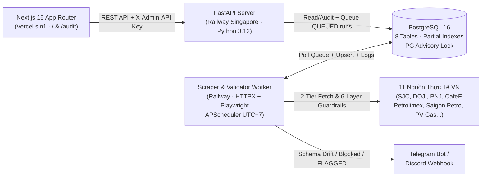

# VXG Tracker

Hệ thống tự động thu thập, kiểm chứng nguồn gốc và hiển thị bảng giá hàng ngày cho **3 mặt hàng thiết yếu tại Việt Nam** (**Vàng**, **Xăng dầu**, **Gas**) tại **Hà Nội (`HN`)**, **Đà Nẵng (`DN`)** và **TP. Hồ Chí Minh (`HCM`)**.

> **Phạm vi Phase 1 (Strict Scope):** Tập trung 100% vào dữ liệu thực tế từ **11 nguồn chính thức và đối chứng**, kiểm chứng **6 tầng an toàn**, lưu trữ chuỗi thời gian sạch theo múi giờ **`Asia/Ho_Chi_Minh` (`UTC+7`)**, cung cấp hồ sơ bằng chứng gốc (`SHA-256` + link nguồn) và minh bạch toàn bộ nhật ký kiểm toán. **Tuyệt đối không** dùng dữ liệu giả lập (mock) và **chưa có** tính năng dự đoán giá (AI forecasting).

---

## Tính năng cốt lõi

- **Thu thập dữ liệu 2 tầng (`2-Tier Fetcher`) & Chống chặn bot:** Ưu tiên `httpx` với HTTP header trình duyệt chuẩn `vi-VN`, retry exponential backoff + jitter, tự động fallback sang **Playwright Chromium** headless khi trang render JavaScript hoặc gặp WAF/cookie challenge.
- **Kiểm chứng 6 tầng (`6-Layer Validation Guardrails`) & Đối chứng chéo:**
  1. Kiểm tra cấu trúc, URL hợp lệ, `SHA-256`, số nguyên `BIGINT` (`VND`).
  2. Chặn giá null, âm hoặc bằng `0`.
  3. Logic nghiệp vụ chuyên ngành (Vàng phải đủ Mua/Bán và `Bán >= Mua`, chênh lệch không vượt ngưỡng; Gas 45kg/48kg nhất quán theo quy cách).
  4. Kiểm tra biên độ giá hợp lý theo từng nhóm mặt hàng.
  5. Chống biến động đột biến (`PRICE_SPIKE_THRESHOLD_PCT`, mặc định `15%`) so với bản ghi `VERIFIED` gần nhất; tự động cách ly (`FLAGGED`) nếu bất thường.
  6. Chuẩn hóa múi giờ `Asia/Ho_Chi_Minh` (`UTC+7`), bảo đảm idempotent upsert và đối chiếu chéo Tier 1 ↔ Tier 2 (`CROSS_CHECKED`).
- **Kho bằng chứng gốc & Chính sách lưu trữ:** Nén `gzip` payload thô kèm mã băm `content_sha256` chống trùng lặp; tự động dọn snapshot quá hạn (`SNAPSHOT_RETENTION_DAYS`, mặc định `90` ngày) nhưng giữ trọn vẹn lịch sử `price_records` và SHA-256 gắn với mức giá mới nhất.
- **Giao diện Financial / Editorial (`Next.js 15` + `Tailwind v4`):** Số liệu căn phải dùng `tabular-nums`, quy đổi tức thì **VND / Lượng ↔ VND / Chỉ**, **Evidence Drawer** truy xuất nguồn gốc, và trang `/audit` theo dõi nhật ký phiên cào, sức khỏe 11 nguồn & cảnh báo.
- **Bảo mật & Cảnh báo vận hành:** Khóa `/api/v1/admin/*` bằng `X-Admin-API-Key` (`hmac.compare_digest`), từ chối khởi động nếu `APP_ENV=production` dùng key yếu/ngắn dưới 24 ký tự, và bắn cảnh báo lỗi nguồn/dữ liệu bất thường qua **Telegram Bot** / **Discord Webhook**.

---

## Kiến trúc Hệ thống & Monorepo



### Cấu trúc Monorepo

| Thành phần | Đường dẫn | Vai trò chính |
| :--- | :--- | :--- |
| **Shared Package** | [`packages/shared-py`](packages/shared-py) | SQLAlchemy 2.0 ORM (8 bảng, 7 custom indexes), Alembic migrations, `Asia/Ho_Chi_Minh` timezone, SHA-256 hashing, `seed.py` idempotent |
| **REST & Audit API** | [`apps/api`](apps/api) | FastAPI `/api/v1/*`, tự map vùng xăng dầu (`HN/DN/HCM -> VUNG_1`), Evidence API, Audit API, Admin queue endpoint |
| **Scraper Worker** | [`apps/worker`](apps/worker) | 2-Tier Fetcher (`httpx` + Playwright Chromium), 11 adapters VN thật, 6-Layer Guardrails, APScheduler `UTC+7` (10 jobs), `AlertNotifier`, Snapshot Retention |
| **Web Dashboard** | [`apps/web`](apps/web) | Next.js 15 App Router (`/` Bảng giá hôm nay, Evidence Drawer, `/audit` Kiểm toán & Nhật ký cào) |
| **CI/CD Workflow** | [`.github/workflows/ci.yml`](.github/workflows/ci.yml) | Pipeline kiểm tra backend (`ruff`, `mypy`, `pytest` + Postgres), frontend (`lint`, `typecheck`, `build`, secret scan) và build 3 Docker images |
| **Hướng dẫn Deploy** | [`docs/DEPLOYMENT.md`](docs/DEPLOYMENT.md) | Tài liệu triển khai chi tiết lên **Railway (Singapore)** + **Vercel** và vận hành/backup PostgreSQL |

---

## Danh sách 11 Nguồn Dữ liệu Thực tế đang Active

| Nhóm | Mã nguồn (`code`) | Phân tầng | Chiến lược | Lịch quét (`Asia/Ho_Chi_Minh`) |
| :--- | :--- | :--- | :--- | :--- |
| **Vàng** | `SJC_OFFICIAL_XML` | Chính thống (`PRIMARY_OFFICIAL`) | `HTTP_JSON` | T2–T7: `08:45, 11:30, 14:30, 17:00`; CN: `09:00` |
| **Vàng** | `DOJI_BOARD` | Chính thống (`PRIMARY_OFFICIAL`) | `PLAYWRIGHT_JS` | Cùng lịch Vàng |
| **Vàng** | `PNJ_HTML` | Chính thống (`PRIMARY_OFFICIAL`) | `PLAYWRIGHT_JS` | Cùng lịch Vàng |
| **Vàng** | `CAFEF_GOLD_CROSSCHECK` | Đối chứng (`SECONDARY_CROSSCHECK`) | `HTTP_JSON` | Cùng lịch Vàng |
| **Xăng dầu** | `PETROLIMEX_FUEL` | Chính thống (`PRIMARY_OFFICIAL`) | `PLAYWRIGHT_JS` | Hàng ngày `07:05` + Thứ 5: `15:15, 15:30, 16:00` |
| **Xăng dầu** | `SAIGONPETRO_FUEL` | Chính thống (`PRIMARY_OFFICIAL`) | `HTTP_HTML` (2 bước) | Cùng lịch Xăng dầu |
| **Xăng dầu** | `WEBGIA_FUEL_CROSSCHECK` | Đối chứng (`SECONDARY_CROSSCHECK`) | `HTTP_HTML` | Cùng lịch Xăng dầu |
| **Gas** | `PETROLIMEX_GAS` | Chính thống (`PRIMARY_OFFICIAL`) | `PLAYWRIGHT_JS` | Hàng ngày `07:30` + Ngày 1–2 đầu tháng: `06:30, 08:30, 10:30` |
| **Gas** | `SAIGONPETRO_GAS` | Chính thống (`PRIMARY_OFFICIAL`) | `HTTP_HTML` (2 bước) | Cùng lịch Gas |
| **Gas** | `PVGAS_LPG` | Chính thống (`PRIMARY_OFFICIAL`) | `PLAYWRIGHT_JS` | Cùng lịch Gas |
| **Gas** | `VIETNAMBIZ_GAS_CROSSCHECK` | Đối chứng (`SECONDARY_CROSSCHECK`) | `HTTP_HTML` (2 bước) | Cùng lịch Gas |

---

## REST & Audit API Endpoints (`/api/v1/...`)

| Method & Path | Bảo vệ | Mô tả |
| :--- | :--- | :--- |
| `GET /health`, `GET /ready` | Công khai | Liveness & Readiness probe kiểm tra PostgreSQL + catalog |
| `GET /docs`, `GET /openapi.json` | Công khai | Swagger UI & OpenAPI schema |
| `GET /api/v1/catalog` | Công khai | Danh sách thành phố (`HN`, `DN`, `HCM`), nhóm hàng, 18 mặt hàng, 11 nguồn active |
| `GET /api/v1/prices/latest` | Công khai | Bảng giá `VERIFIED`/`CROSS_CHECKED` mới nhất (lọc `location`, `domain`; tự map `FUEL -> VUNG_1`) |
| `GET /api/v1/prices/{record_id}/evidence` | Công khai | Toàn bộ bằng chứng nguồn gốc, SHA-256, mã phiên cào, kết quả đối chứng & 6 tầng kiểm tra |
| `GET /api/v1/audit/summary` | Công khai | Chỉ số minh bạch theo ngày hôm nay (`UTC+7`) và 7 ngày gần nhất |
| `GET /api/v1/audit/runs` | Công khai | Lịch sử các phiên cào (hỗ trợ phân trang `limit`/`offset`, lọc `scope`/`status`) |
| `GET /api/v1/audit/runs/{run_id}` | Công khai | Log chi tiết từng nguồn (`crawl_source_logs`) trong một phiên cào |
| `GET /api/v1/sources/health` | Công khai | Tỷ lệ thành công 7 ngày, độ trễ trung bình và trạng thái hiện tại của 11 nguồn active |
| `GET /api/v1/audit/anomalies` | Công khai | Danh sách cảnh báo `anomaly_alerts` (`OPEN` / `ACKNOWLEDGED` / `RESOLVED`) |
| `POST /api/v1/admin/crawl-runs` | `X-Admin-API-Key` | Đẩy job (`ALL`/`GOLD`/`FUEL`/`GAS`) vào hàng đợi PostgreSQL (`202` / `409 Conflict` chống spam) |

---

## Chạy nhanh trên Local (Docker Compose)

Yêu cầu: Docker Desktop (Docker Compose v2+).

1. **Tạo file biến môi trường `.env` từ [`.env.example`](.env.example):**
   - **Windows PowerShell:**
     ```powershell
     Copy-Item .env.example .env
     ```
   - **macOS / Linux:**
     ```bash
     cp .env.example .env
     ```
2. **Khởi chạy toàn bộ 5 dịch vụ (`postgres`, `migrator`, `api`, `worker`, `web`):**
   ```bash
   docker compose up --build -d
   ```
3. **Nạp dữ liệu giá thực tế ngay lần đầu (không cần chờ tới khung giờ cron):**
   ```bash
   docker compose exec worker python -m vxg_worker.cli run --scope ALL
   ```
   *(Hoặc vào trang `http://localhost:3000/audit`, bấm **Chạy cào thủ công** và nhập khóa mặc định local `change-me-local-admin-key` từ `.env.example`.)*
4. **Truy cập các dịch vụ local:**
   - **Bảng giá hôm nay:** `http://localhost:3000` (hỗ trợ `?city=HN|DN|HCM`)
   - **Minh bạch & Nhật ký cào:** `http://localhost:3000/audit`
   - **Swagger OpenAPI Docs:** `http://localhost:8000/docs`
   - **Health / Readiness:** `http://localhost:8000/health` và `http://localhost:8000/ready`

---

## Kiểm thử & Phát triển trên Local

Khi chạy công cụ lint/test trực tiếp từ Python `.venv` hoặc Node/pnpm trên máy host:

```powershell
# Backend static checks & unit/integration tests (Windows PowerShell)
.\.venv\Scripts\ruff.exe check packages apps/api apps/worker tests
.\.venv\Scripts\mypy.exe packages/shared-py/src apps/api/src apps/worker/src tests
.\.venv\Scripts\pytest.exe tests/unit -v
.\.venv\Scripts\pytest.exe tests/integration -v   # cần PostgreSQL đang chạy trên localhost:5432

# Frontend static checks & production build
pnpm --dir apps/web lint
pnpm --dir apps/web typecheck
pnpm --dir apps/web build
```

Hoặc sử dụng các target tiện ích trong [`Makefile`](Makefile) (macOS / Linux / WSL):

| Lệnh `Makefile` | Tác dụng |
| :--- | :--- |
| `make up` / `make down` | Khởi chạy hoặc tắt toàn bộ Docker Compose stack |
| `make migrate` / `make seed` | Chạy Alembic migration & seed danh mục chuẩn hóa (idempotent) |
| `make test` | Chạy offline unit tests (`tests/unit`, gồm Golden Fixtures, Guardrails & Production Hardening) |
| `make test-integration` | Chạy integration tests với PostgreSQL thật (`tests/integration`) |
| `make lint` | Chạy `ruff check` và `mypy` strict trên toàn bộ Python codebase |
| `make web-build` | Chạy `eslint`, `tsc --noEmit` và `next build` cho `apps/web` |
| `make prune-snapshots` | Chạy dọn `raw_evidence_snapshots` quá hạn lưu trữ (`SNAPSHOT_RETENTION_DAYS`) |

---

## Bảo mật & Triển khai Production

- `.env` được loại trừ trong [`.gitignore`](.gitignore) — **tuyệt đối không** commit secret hoặc đặt `ADMIN_API_KEY` vào biến `NEXT_PUBLIC_*` trên Vercel.
- Khi thiết lập `APP_ENV=production`, `vxg-api` sẽ từ chối khởi động nếu `ADMIN_API_KEY` rỗng, giữ giá trị mặc định hoặc ngắn hơn 24 ký tự.
- Xem hướng dẫn từng bước cấu hình GitHub Actions, Railway (Singapore) cho PostgreSQL + `vxg-api` + `vxg-worker`, Vercel cho `apps/web`, Telegram/Discord alerting và backup/khôi phục dữ liệu tại [`docs/DEPLOYMENT.md`](docs/DEPLOYMENT.md).
